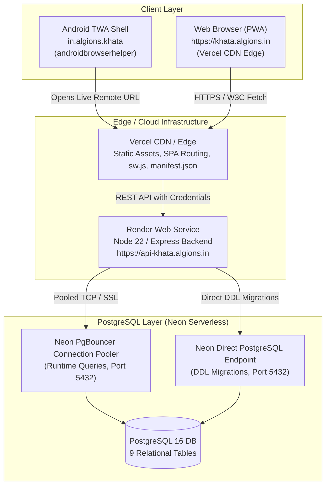
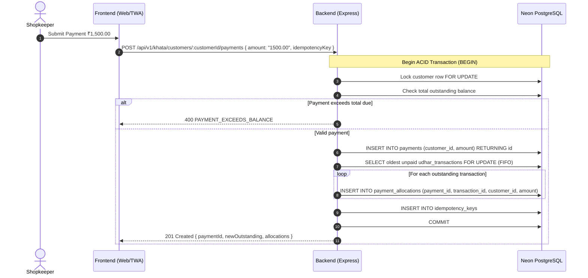

# Khata — System Architecture & Data Flow

**Document Status:** Canonical & Implemented  
**Last Verified:** 2026-11-01  
**Target Audience:** Software Engineers, DevOps, System Architects  

---

## 1. High-Level Architecture Overview

Khata follows a decoupled client-server architecture designed for high availability, zero floating-point arithmetic corruption, and seamless cross-platform execution across Web and Android.

The Android app and the website are two interfaces for the **same shopkeeper and the same account**. Both interfaces communicate with the same backend API and PostgreSQL database.

---

## 2. Technology Stack

| Layer | Technologies & Rationale |
|---|---|
| **Frontend Web** | React 19, TypeScript 5, Vite 6, Tailwind CSS 3, Lucide React. Progressive Web App (PWA) with Network-First Service Worker (`sw.js`). Custom `SearchablePicker` with debounced search, monotonic request IDs, and focus trap. Self-hosted `@fontsource/montserrat` for 100% offline typography. |
| **Android Shell** | Trusted Web Activity (TWA) via `androidbrowserhelper:2.5.0` and `androidx.browser:1.8.0`. Package ID: `in.algions.khata`. Renders live remote site `https://khata.algions.in` in full screen with no browser URL bar. |
| **Backend API** | Node.js 22 LTS, Express 4, TypeScript 5, `pg` (PostgreSQL client). Monorepo structure managed with native npm workspaces. |
| **Financial Engine** | `decimal.js` for arbitrary-precision decimal arithmetic (financial rounding half-up, strict 2-decimal-place scale for money and fractional quantities up to 2 decimal places). |
| **Database** | PostgreSQL 16 on Neon Serverless. Enforces foreign key constraints, unconstrained `NUMERIC` with `TRUNC` scale checks, composite payment allocation foreign keys, unique indexes, and ACID transactions. |
| **Security & Auth** | Argon2id for password hashing, host-only `httpOnly` secure session cookies, double-submit CSRF cookie protection, `express-rate-limit`. |

---

## 3. Financial Transaction & Payment Allocation Flow

---

## 4. Service Worker & Caching Strategy

The Progressive Web App service worker (`frontend/public/sw.js`) guarantees that:
1. **HTML Documents & Navigation:** Always use **Network-First** with cache fallback. Any new deployment to Vercel is immediately fetched on reload or app open.
2. **Versioned Static Assets:** Immutable bundles (`/assets/*.[hash].js|css`) use **Cache-First** for instant performance.
3. **API Requests (`/api/*`):** **STRICTLY EXCLUDED** from Service Worker caching. Financial data, customer ledger entries, authentication sessions, and CSRF tokens are never written to client cache storage.
