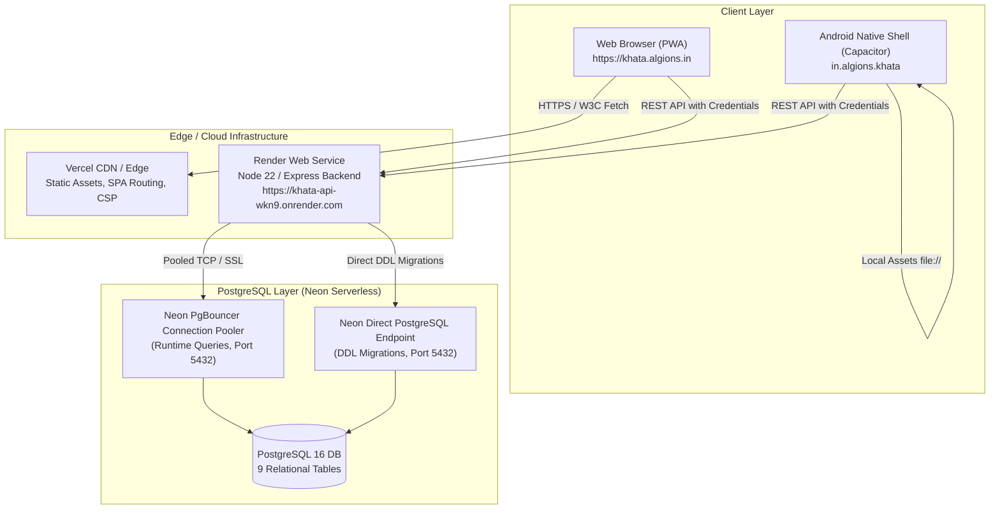
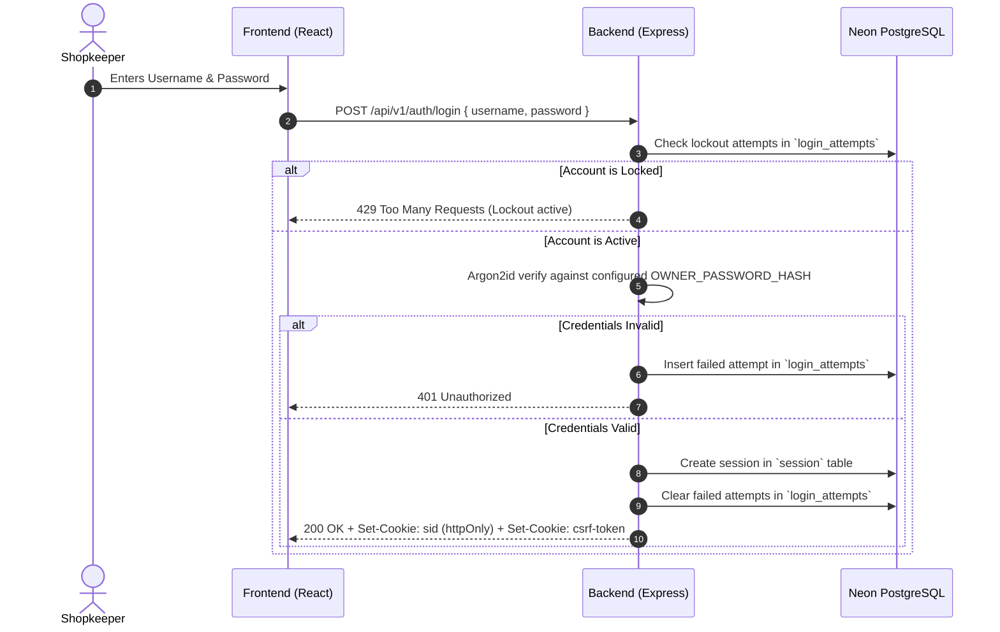
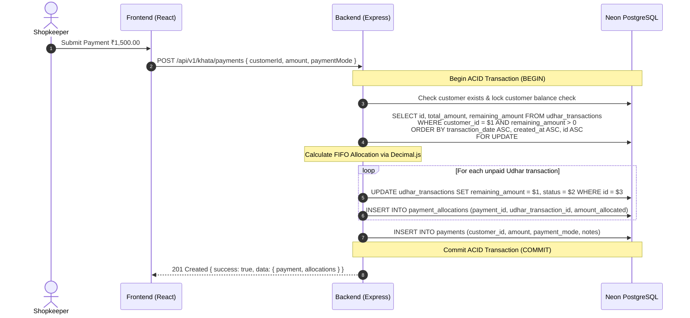

# Khata - System Architecture & Data Flow

**Document Status:** Canonical & Implemented  
**Last Verified:** 2026-11-01  
**Target Audience:** Software Engineers, DevOps, System Architects  

---

## 1. High-Level Architecture Overview

Khata follows a decoupled client-server architecture designed for high availability, zero floating-point arithmetic corruption, and secure cross-platform execution (Web and Android).



---

## 2. Technology Stack

| Layer | Technologies & Rationale |
|---|---|
| **Frontend Web** | React 19, TypeScript 5, Vite 6, Tailwind CSS 3, Lucide React.<br>Bundled locally with `@fontsource/montserrat` for 100% offline rendering.<br>Custom `SearchablePicker` with debounced server-side search (`useRemoteSearch`), responsive bottom-sheet for mobile, and bounded pagination. |
| **Mobile Runtime** | Capacitor 7 Android platform shell. Embeds frontend build into native Android Webview with local asset caching. |
| **Backend API** | Node.js 22 LTS, Express 4, TypeScript 5, `tsx` runner, `pg` (PostgreSQL client).<br>Monorepo structure managed with native npm workspaces. |
| **Financial Engine** | `decimal.js` for arbitrary-precision decimal arithmetic (financial rounding half-up, strict 2-decimal-place strings). |
| **Database** | PostgreSQL 16 on Neon Serverless. Enforces foreign key constraints, check constraints, unique indexes, and ACID transactions. |
| **Security & Auth** | Argon2id for password hashing, host-only `httpOnly` secure session cookies, double-submit CSRF cookie protection, `express-rate-limit`. |

---

## 3. Core Data Flow & Transaction Sequences

### 3.1 Owner Authentication Flow



### 3.2 Payment Settlement Flow (FIFO Allocation)



---

## 4. Repository Structure & Workspace Layout

The repository is structured as an npm workspaces monorepo:

```text
khata/
├── backend/                  # Express REST API workspace
│   ├── scripts/              # Migration runner (scripts/migrate.ts)
│   ├── src/
│   │   ├── config/           # Database pool, env parser, testDbGuard
│   │   ├── middleware/       # Auth guards, CSRF, rate-limit, error handler
│   │   ├── migrations/       # SQL migration files (001, 002, 003)
│   │   ├── modules/
│   │   │   ├── auth/         # Login, logout, session verification
│   │   │   ├── customers/    # Customer directory & balances
│   │   │   ├── khata/        # Udhar recording, FIFO payments, ledger statements
│   │   │   └── products/     # Product catalog CRUD
│   │   └── app.ts            # Express application bootstrap
│   └── tests/                # Vitest test suite (financial, auth, testDbGuard)
├── frontend/                 # Vite + React workspace
│   ├── android/              # Capacitor native Android shell
│   ├── public/               # Static assets & icons
│   └── src/
│       ├── components/       # Layout, Navbar, AccessibilityBar, Modal
│       ├── context/          # ThemeContext (9 Neumorphic presets)
│       ├── features/         # KhataLedgerView, ProductsView, CustomersView, LoginView
│       ├── services/         # Typed API clients with AbortController
│       └── index.css         # Custom Neumorphic CSS variables & accessibility scaling
├── docs/                     # Canonical project documentation
│   └── archive/              # Superseded historical audit records and prompts
├── package.json              # Monorepo root package.json with workspace scripts
└── package-lock.json         # Committed deterministic npm lockfile
```

---

## 5. Security & Isolation Boundaries

1. **Host-Only Sessions:** Session cookies omit `Domain` attribute to prevent subdomain leakage across unrelated services on `algions.in`.
2. **Strict CORS Policy:** Production backend origin reflects only the configured frontend domain (`https://khata.algions.in`), rejecting unauthorized cross-origin calls.
3. **Double-Submit CSRF:** Mutating requests (`POST`, `PUT`, `DELETE`) require `X-CSRF-Token` header matching the signed CSRF cookie.
4. **Destructive Test Guard:** `backend/src/config/testDbGuard.ts` strictly prevents test suites from executing against production Neon hostnames or unapproved cloud databases.
