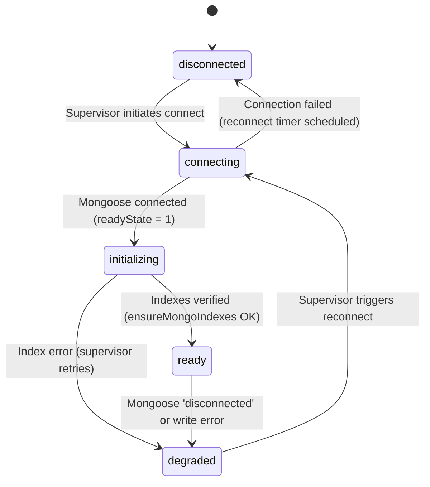

# Khata ERP — Release #031 Mandatory MongoDB Availability & Supervisor Guide

**Release:** `#031`  
**Company:** ALGIONS AI LABS PRIVATE LIMITED  
**Architecture Domain:** Dual-Database Consistency, Connection Supervision, Fail-Closed Read Models, Global Availability Gating

---

## 1. Executive Mandate — MongoDB is Compulsory

In Khata ERP Release 031, **MongoDB is mandatory for the normal operation of the application.**

Any architectural suggestion that MongoDB should be an "optional" dependency with an automatic, silent PostgreSQL fallback has been permanently superseded.

### 1.1 Why Silent Fallback Was an Anti-Pattern
1. **Hidden Infrastructure Outages:** Silent fallback masks database outages from operations teams. If MongoDB drops connections, traffic silently floods PostgreSQL, creating massive connection spikes and driving database CPU to 100%.
2. **Split-Brain Read Models:** When falling back to PostgreSQL queries that omit projection aggregations or pagination bindings, search tokens and keyset pagination behave differently between normal and fallback states.
3. **Database Responsibility Violation:** PostgreSQL is sized and provisioned on Neon for strict ACID transactional consistency, row locking, and financial integrity. It must not absorb unbounded product search, customer summary sorting, and frequent dashboard overview scans.

---

## 2. Strict Division of Database Responsibilities

```text
                     KHATA ERP APPLICATION
                              |
                              |
                       EXPRESS BACKEND
                              |
                 MANDATORY DEPENDENCIES
                              |
              -------------------------------
              |                             |
              |                             |
       POSTGRESQL                       MONGODB
       AUTHORITATIVE                    MANDATORY
       DATABASE                         DATABASE
              |                             |
      -----------------             ------------------
      |       |       |             |       |        |
    Khata   Payments Invoices     Product Customer Dashboard
    Ledger Financial GST          Search  Summary  Read Models
      |       |       |             |       |        |
      -----------------             ------------------
              |                             |
              |                             |
     Financial Integrity            Search & Fast Projections
     Row-Level Locking              Keyset Pagination
     FIFO Allocations               Full-Text Token Indexing
     Double-Entry Constraints       Aggregated Snapshots
```

### 2.1 The Two Database Contracts:
1. **PostgreSQL Contract:** Authoritative system of record for all money, transactions, invoices, bills, payments, allocations, supplier records, and outbox logs.
2. **MongoDB Contract:** Authoritative read model projection for fast fuzzy catalogue search, customer outstanding sorting, cached dashboard analytics, and app preferences.

---

## 3. The MongoConnectionSupervisor

Instead of crashing the Node.js process (`process.exit(1)`) on initial MongoDB connection failure, Release 031 introduces `MongoConnectionSupervisor` (`backend/src/services/mongoConnectionSupervisor.ts`).

### 3.1 Supervisor Responsibilities
1. **Non-Fatal Boot:** If MongoDB is unreachable on startup, the Express application starts normally, establishes PostgreSQL connections, and begins accepting health probe requests.
2. **Continuous Reconnection:** The supervisor runs an exponential backoff reconnection loop with jitter.
3. **Index Guarantee:** Once a Mongoose connection is established, the supervisor executes `ensureMongoIndexes()`. The service is NOT marked `ready` until all indexes are initialized.
4. **Outbox Worker Coordination:** When MongoDB disconnects, the supervisor automatically pauses the `ReadModelOutboxWorker`. When MongoDB recovers, it triggers `worker.catchUpOnStartup()` to drain accumulated outbox events.

### 3.2 State Machine



### 3.3 Exponential Backoff with Uniform Jitter
Reconnection attempts follow the formula:
$$\text{Delay} = \min(\text{maxDelay}, \text{baseDelay} \times 2^{\text{attempt}-1}) \times (0.8 + 0.4 \times \text{random})$$
- `baseDelay`: $1,000 \text{ ms}$
- `maxDelay`: $60,000 \text{ ms}$
- Jitter factor: $[0.8, 1.2]$ uniform distribution, eliminating thundering herd problems across clustered web workers.

---

## 4. Fail-Closed Read Models Policy

When MongoDB is unavailable or disconnected:
1. **Search & Read Endpoints:** Endpoints return HTTP 503 `READ_MODEL_UNAVAILABLE` or `MANDATORY_SERVICE_UNAVAILABLE`.
2. **Zero Fallback to PostgreSQL:** The backend does **not** fall back to issuing table scans or `ILIKE` queries against PostgreSQL for customer search, product catalogue search, or dashboard overview.
3. **Transactional Financial Operations Unaffected:** Owner payments, bill creations, invoice numbering, and ledger transactions execute directly against PostgreSQL without dependency on MongoDB.

---

## 5. Health Check Architecture: Liveness vs. Readiness

Release 031 establishes clear separation between Kubernetes/Render probes:

### 5.1 `/api/v1/health/live` (Liveness Probe)
- **Status:** HTTP 200
- **Purpose:** Checks if the Node.js process event loop is alive and responsive.
- **Query Count:** **Strictly zero database queries** (zero PostgreSQL queries, zero MongoDB queries).
- **Behavior:** Never returns 500/503 during database downtime, preventing container restart loops.

```json
{
  "status": "alive",
  "process": "healthy",
  "timestamp": "2026-11-12T10:00:00.000Z",
  "uptime": 124.5
}
```

### 5.2 `/api/v1/health/ready` (Readiness Probe)
- **Status:** HTTP 200 when ready, HTTP 503 when unready.
- **Purpose:** Verifies that both PostgreSQL and MongoDB are connected and ready to serve customer traffic.
- **Behavior:** Returns 503 if PostgreSQL is unreachable, MongoDB is disconnected, or MongoDB indexes are still compiling.

```json
{
  "status": "ready",
  "ready": true,
  "services": {
    "postgres": "ready",
    "mongodb": "ready"
  },
  "timestamp": "2026-11-12T10:00:00.000Z"
}
```

---

## 6. Global Availability Gate (`requireMandatoryServices`)

Located at `backend/src/middleware/requireMandatoryServices.ts`, this Express middleware sits in the request pipeline before business routes:

```typescript
export function requireMandatoryServices(req: Request, res: Response, next: NextFunction): void {
  const normalizedPath = req.path.replace(/\/+$/, '') || '/';
  if (EXEMPT_PATHS.has(normalizedPath)) {
    next();
    return;
  }

  if (!mongodbConfig.isMongoReady()) {
    const mongoState = mongodbConfig.getMongoAvailabilityState();
    res.setHeader('Cache-Control', 'no-store, no-cache, must-revalidate, private');
    res.status(503).json({
      success: false,
      code: 'MANDATORY_SERVICE_UNAVAILABLE',
      message: 'Khata ERP is temporarily unavailable because a mandatory database service is not ready.',
      services: { mongodb: mongoState },
      retryable: true,
    });
    return;
  }
  next();
}
```

- Exempted paths: `/api/v1/health/live`, `/api/v1/health/ready`, `/api/v1/health`.
- All other routes fail closed with HTTP 503 if MongoDB is unready in production.
