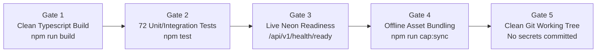

# Khata - Testing Matrix & Release Acceptance Criteria

**Document Status:** Canonical & Implemented  
**Last Verified:** 2026-11-01  
**Test Suite Status:** 72 / 72 Passing (100%)  
**Runner:** Vitest with TypeScript  

---

## 1. Automated Test Suites & Coverage

The backend test suite verifies financial accuracy, row-locking safety, search pagination, decimal quantity precision, and authentication security.

| Test Suite | File Location | Test Count | Key Invariants Verified |
|---|---|---|---|
| **Database Guard** | [backend/tests/testDbGuard.test.ts](file:///c:/Users/rajab/OneDrive/Desktop/khata/backend/tests/testDbGuard.test.ts) | 7 tests | Blocks Neon production hosts (`*.neon.tech`), cloud DBs, rejects unapproved test URLs, permits localhost/test DBs. |
| **Validators & Normalizers** | [backend/tests/validators.unit.test.ts](file:///c:/Users/rajab/OneDrive/Desktop/khata/backend/tests/validators.unit.test.ts) | 9 tests | Decimal quantity validation (up to 2dp), money scale validation, ILIKE wildcard escaping, customer phone and name normalization. |
| **Search & Pagination** | [backend/tests/search.api.test.ts](file:///c:/Users/rajab/OneDrive/Desktop/khata/backend/tests/search.api.test.ts) | 9 tests | Case-insensitive product search (`LOWER(name)`), customer phone normalization search, bounded pagination (`LIMIT/OFFSET`), and parameter safety. |
| **Financial Correctness** | [backend/tests/khata.financial.test.ts](file:///c:/Users/rajab/OneDrive/Desktop/khata/backend/tests/khata.financial.test.ts) | 18 tests | Strict FIFO allocation, overpayment prohibition, decimal quantity policy (1.5, 2.25, 0.01), customer phone normalization & conflict resolution, 2-decimal string serialization, non-aggregated `FOR UPDATE` locking. |
| **Authentication & Security** | [backend/tests/auth.security.test.ts](file:///c:/Users/rajab/OneDrive/Desktop/khata/backend/tests/auth.security.test.ts) | 29 tests | Argon2id verification, lockout counters, exponential backoff, advisory lock pruning, CSRF protection, `/api/v1/health/ready` check. |
| **Total Automated Tests** | | **72 tests** | **All 72 passing (100%)** |

---

## 2. Test Execution Commands

```bash
# Execute full backend test suite from repository root:
npm test

# Run tests in watch mode during development:
npm run test:watch --workspace=backend

# Run type checking across workspaces:
npm run build
```

---

## 3. Financial Invariant Verification Cases

### Case 1: FIFO Payment Allocation
- Customer owes 3 separate Udhar transactions:
  - Tx 1: ₹500.00 (oldest)
  - Tx 2: ₹300.00
  - Tx 3: ₹200.00
- Customer submits Payment of ₹650.00.
- Result:
  - Tx 1 `remaining_amount` becomes ₹0.00 (`PAID`).
  - Tx 2 `remaining_amount` becomes ₹150.00 (`PARTIAL`).
  - Tx 3 `remaining_amount` remains ₹200.00 (`UNPAID`).
  - Net outstanding balance becomes ₹350.00.
  - Exact sum preserved without fractional cent drift.

### Case 2: Overpayment Rejection
- Customer owes total ₹400.00.
- Payment of ₹400.01 is submitted.
- Result: Transaction aborts immediately with `400 Bad Request` (`OVERPAYMENT_NOT_ALLOWED`). No funds allocated.

### Case 3: Zero or Negative Payment Rejection
- Submission of ₹0.00 or -₹50.00 is rejected with `400 Bad Request` (`INVALID_PAYMENT_AMOUNT`).

---

## 4. Release Acceptance Gates

Every production release candidate must pass all five verification gates prior to deployment:



1. **Gate 1: Monorepo Compilation** - `npm run build` completes with zero TypeScript or Vite errors.
2. **Gate 2: Financial & Security Test Suite** - 72/72 vitest tests pass.
3. **Gate 3: Live Readiness Probe** - `/api/v1/health/ready` returns HTTP 200 with all 9 core tables verified.
4. **Gate 4: Mobile Shell Synchronization** - `npx cap sync android` copies latest web bundle and fonts into Android assets.
5. **Gate 5: Clean Working Tree** - No credentials, keystores, or build caches committed to version control.
